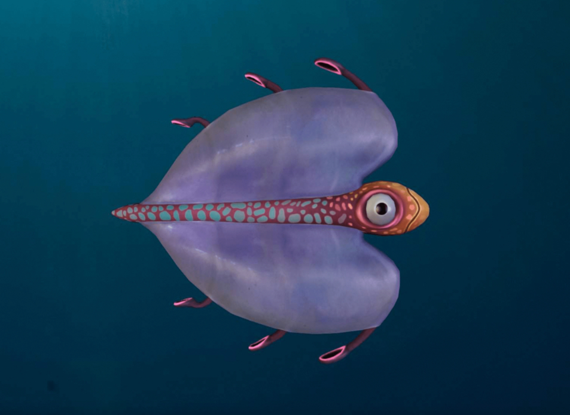

# Příručka přežití Subnautice

## Kapitola 1) Organismy
- Planetu obývá obrovské množství *nebezpečných* organismů
- Planeta je také infikovaná smrtelnou nemocí Kharaa (na kterou **musíte** najít lék)
- Za každou cenu se **vyhýbejte** rotorům Aurory
### 1.1) Strava a pití
Pro přežití na planetě 4546B je strava a pitný režim nejdůležitější
- Voda: před získání blueprintů pro filtrační zařízení se dá výborně využít *měchýřovec* jako zdroj vody

- Jídlo: Živit se dá valnou většinou malých rybiček **po tepelném upravení**
1. Čumík
2. Garryba
3. Vznášelka
### 1.2) Fauna
- Většina rostlin jsou nevinné a neškodné
Na planetě se nachází třeba lanpovník nebo vodní meloun a dají se využít jako skvělý zdroj potravy
## Kapitola 2) Co dělat?
- Při přislání byl vyslán nouzový signál, bohužel záchraná loď by měla dorazit za 99999999 minut
### 2.1) Plán
- [x] Zajistit jídlo a pití 
- [ ] Vyléčit se 
- [x] Vybudovat základnu 
- [ ] Zjistit co se na planetě děje
- [ ] Uniknout z planety

### 2.2) Srovnání zdrojů obživy

Více informací najdeš na [Subnautica Wiki](https://subnautica.fandom.com/) nebo v [oficiální příručce na Steamu](https://steamcommunity.com/)):

| Organismus | Typ | Přínos (jídlo / voda) | Poznámka |
| :--- | :---: | :---: | :--- |
| **Měchýřovec** | Ryba | +10 / +15 | Nejlepší zdroj vody na začátku hry |
| **Čumík** | Ryba | +32 / +5 | Nutné tepelně upravit |
| **Vodní meloun** | Flóra | +12 / +14 | Skvělý pro pěstování na základně |

